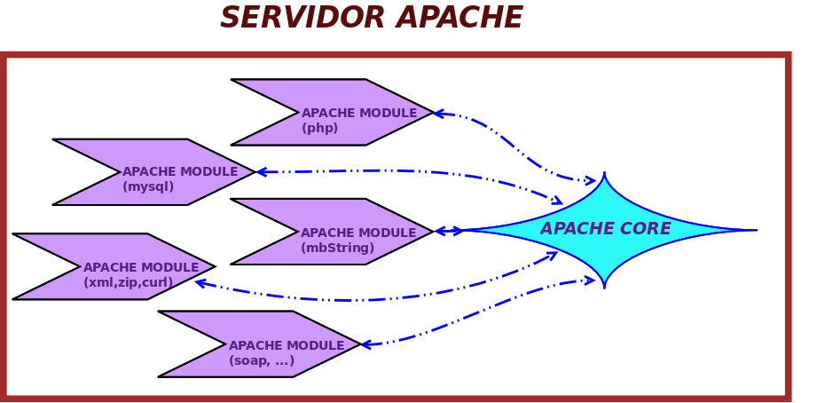
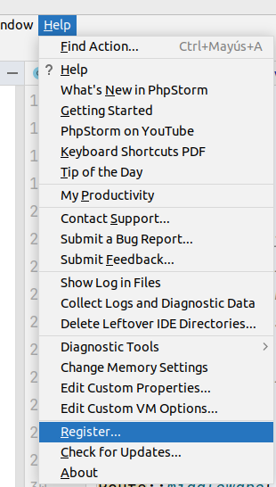
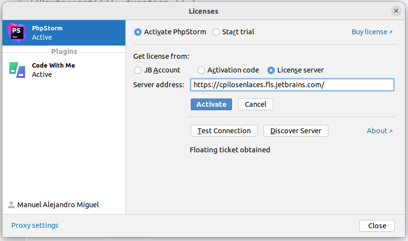
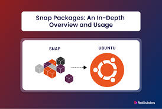

# Herramientas y aplicaciones necesarias

::: pageinfo
Para el desarrollo web necesitamos los siguientes programas.

Realizaremos las instalacines y a lo largo del curso aprenderemos y profundizaremos en su conocimeinto


<CardPane>
<Card header="Apache 2" href="https://httpd.apache.org/" color="#d22128" :src="imgApache">
Servidor web http/https
</Card>

<Card header="PHP" href="https://www.php.net/manual/es/intro-whatis.php" color="#4F5B93" :src="imgPhp">
Lenguaje de programación en el servidor
</Card>

<Card header="MySQL" href="https://www.mysql.com/" color="#00758f" :src="imgMysql">
Gestor de bases de datos relacionales
</Card>

<Card header="Xdebug" href="https://xdebug.org/" color="#922e2e" :src="imgXdebug">
Aplicación para depurar (interactuar durante la ejecución)
</Card>

<Card header="PhpStorm" href="https://www.jetbrains.com/es-es/phpstorm/" color="#b345f1" :src="imgPhpstorm">
IDE para desarrollar o programar
</Card>
</CardPane>
:::

## Instalando en Ubuntu

### Instalando en Ubuntu

Para instalar programas en Ubuntu utilizamos habitualmente **APT** (*Advanced Package Tool*), una herramienta que permite gestionar los paquetes de software desde la terminal.

Ubuntu dispone de **repositorios de software** configurados en el sistema, desde los que podemos descargar e instalar paquetes. También podemos añadir nuevos repositorios mediante sus direcciones URL.

Antes de instalar programas, es recomendable actualizar la información sobre los paquetes disponibles:

```bash
# Actualizar la lista de paquetes disponibles
sudo apt update
```
A continuación, instalamos **Apache HTTP Server** (`apache2`), un servidor web que implementa el protocolo **HTTP** y permite atender las peticiones de los clientes (navegadores web).

```bash
# Instalar el servidor web Apache
sudo apt install apache2
```

Una vez instalado, Apache normalmente se inicia automáticamente y podemos comprobar su funcionamiento accediendo desde el navegador a:

http://localhost


Si Apache no estuviese arrancado, podemos iniciarlo mediante `systemctl` o `service`.

Estos comandos permiten **gestionar los servicios de Ubuntu**, realizando acciones como:

- `start`: iniciar el servicio.
- `stop`: detenerlo.
- `restart`: reiniciarlo.
- `reload`: recargar su configuración sin reiniciar el servicio, si lo admite.

```bash{2,6,10}
# Iniciar Apache (una de las dos opciones)
sudo systemctl start apache2
sudo service apache2 start 

# Reiniciar Apache (dos alternativas)
sudo systemctl restart apache2
sudo service apache2 restart

# Consultar su estado (las dos opciones)
sudo systemctl status apache2
sudo service apache2 status
```

La sintaxis general es `sudo systemctl ACCIÓN SERVICIO`. En Ubuntu actual se recomienda utilizar `systemctl`.

### Instalando en Windows con XAMPP

XAMPP es una solución sencilla para tener Apache, PHP y MySQL en Windows. Sigue estos pasos para instalarlo:

<Color>Descargar XAMPP</Color>

Ve al sitio web oficial de XAMPP [https://www.apachefriends.org](https://www.apachefriends.org) y descarga la versión que incluye PHP.

<Color>Instalar XAMPP</Color>

Ejecuta el instalador y sigue las instrucciones. Asegúrate de seleccionar Apache y PHP durante la instalación.

<Color>Iniciar los servicios</Color>:

Abre el panel de control de XAMPP y asegúrate de iniciar Apache.

<Color>Comprobar instalación</Color>

Abre tu navegador y visita `http://localhost/`. Deberías ver la página de bienvenida de XAMPP.


## Servidor Apache y su funcionamiento modular



Como se muestra en la imagen, Apache funciona mediante un sistema de módulos.

Cada uno de estos módulos (como **PHP**, **MySQL**, **XML**, entre otros) añade funcionalidades específicas y se conecta al **núcleo de Apache**.

Puedes **activar o desactivar, instalar o desinstalar módulos** según tus necesidades, **_manteniendo solo aquellos que sean esenciales_**.

Es importante recordar que, al instalar Apache, se abre una "puerta" en el sistema hacia redes externas, lo que puede representar una exposición al exterior.

Al poner en funcionamiento un servidor web, **podemos permitir conexiones desde otros equipos**, lo que hace necesario prestar atención a su seguridad.

Para minimizar esta exposición, es importante:

- **Mantener actualizados** tanto Apache como sus módulos.
- **Configurar adecuadamente** los permisos y accesos, permitiendo únicamente los necesarios.
- **Deshabilitar módulos innecesarios**, reduciendo así las posibles vulnerabilidades.

Recuerda que el uso seguro de Apache es esencial para proteger el servidor y los d


## Instalación de phpstorm
::: definicion ¿Qué es PhpStorm?
- PhpStorm es un entorno de desarrollo integrado (IDE) diseñado específicamente para el desarrollo en PHP. 
- - Ofrece herramientas avanzadas como depuración, soporte para frameworks, integración con control de versiones y edición de HTML, CSS y JavaScript, todo en una interfaz intuitiva.
  :::


### Instalación en ubuntu

<Color>PhpStorm se puede instalar fácilmente en sistemas Ubuntu utilizando Snap.</Color> Snap es un sistema de paquetes que resuelve problemas de dependencias y simplifica las instalaciones en Ubuntu (introducido desde la versión 16.04).


---


<Color>Instalación mediante Snap</Color>

1. Asegúrate de tener Snap habilitado. Para más información sobre Snap, consulta:

::: referencias Guía básica
  <https://blogubuntu.com/que-es-ubuntu-snap>
:::


2. Ejecuta el siguiente comando para instalar PhpStorm:
```bash{1}
   sudo snap install phpstorm --classic
```

<Color>Instalación manual</Color>

Si prefieres instalar PhpStorm manualmente:

1. Descarga el archivo desde el sitificial:

```bash
   wget https://download.jetbrains.com/webide/PhpStorm-2020.2.2.tar.gz
```

2. Extrae el contenido en el directorio recomendado `/opt`:

```bash
   sudo tar xvfz PhpStorm-2020.2.2.tar.gz -C /opt/
```

::: definicion Parámetros del comando tar
- **x**: Extraer archivos.
- **f**: Utilizar un archivo.
- **z**: Operar sobre un archivo comprimido gzip.
- **v**: Mostrar las acciones de forma detallada (verbose).
:::


3. Cambia al directorio de instalación y ejecuta el script:
4. 
```bash
   cd /opt/PhpStorm-181.5281.19/bin
   ./phpstorm.sh
```

### Instalación en Windows

1. Visita la página de descarga:
::: referencias Instalación guiada
 <https://www.jetbrains.com/es-es/phpstorm/download/#section=windows>
:::


2. Descarga y ejecuta el instalador siguiendo los pasos indicados.


---


### Activar la licencia de phpstorm a través del instituto

Abrimos el <Color>IDE PhpStorm</Color>. Si es la primera vez, se nos pedirá que aportemos la licencia o que iniciemos la versión gratuita de 30 días. Si ya hemos iniciado previamente, podemos acceder al registro desde el menú **Help**.


1. Se visualizará una página para activar la licencia.
2. Seleccionamos la opción de activación mediante servidor de licencias.
   

3. Establecemos la siguiente URL del servidor:
```bash{1}
   https://cpilosenlaces.fls.jetbrains.com
```

4. Finalmente, presionamos la opción **Activate** para completar el proceso.

::: details ¿Por qué usar Snap para instalar PhpStorm?


*Snap resuelve problemas de dependencias y ofrece una instalación rápida y segura, ideal para mantener PhpStorm actualizado automáticamente.*
:::


::: info Nota adicional
Si tienes alguna duda, consulta la sección de preguntas frecuentes de JetBrains o contacta al soporte.
:::


### Temas de permisos de **Apache**

A pesar de que no somos administradores/as, debemos tener conocimientos sobre ciertos temas.  
Lo primero que debemos tener claro es que cuando **PHP** le dice en el script a Apache que actúe sobre el sistema de ficheros, en última instancia, es el usuario **apache** quien ejecuta las acciones.

Lee atentamente el siguiente cuadro y asegúrate de entender cada punto; si no, pregunta.

#### Puntos fundamentales sobre permisos

1. En **Linux**, todo **fichero** tiene un **propietario**, y también todo **proceso** o **aplicación**, como lo es <Color>el servidor web apache</Color>.
    - El **propietario** del proceso es el **usuario que lanzó** dicho proceso.
    - Cuando un proceso quiere actuar sobre un fichero, el usuario que lo lanzó debe tener **permisos sobre el fichero**.
    - El usuario que lanza el programa o servicio **Apache** es **www-data**.
    - Para cambiar el propietario de un fichero o su grupo, usamos la siguiente sentencia:

```php{1}
   sudo chown usuario:grupo fichero (-R)
```

**Nota**: El parámetro `-R` es opcional y actúa de forma recursiva.

2. En PHP, un **directorio es igual que un fichero** cuyo contenido son los ficheros y directorios que contiene.

### Para dar permisos sobre un fichero a un usuario

Usamos la siguiente sentencia:

```php{1}
sudo chmod permisos fichero (-R)
```

**Nota**:
- **permisos** es un número de tres dígitos en **octal** (ver tabla abajo).
- **fichero** es el archivo al cual queremos asignar permisos; se puede usar `*` para aplicar a todos.
- `-R` es un parámetro opcional que actúa de forma recursiva.

| Número | Binario | Lectura (r) | Escritura (w) | Ejecución (x) |
| ------ | ------- | ----------- | ------------- | ------------- |
| 0      | 000     | ❌          | ❌            | ❌            |
| 1      | 001     | ❌          | ❌            | ✔️            |
| 2      | 010     | ❌          | ✔️            | ❌            |
| 3      | 011     | ❌          | ✔️            | ✔️            |
| 4      | 100     | ✔️          | ❌            | ❌            |
| 5      | 101     | ✔️          | ❌            | ✔️            |
| 6      | 110     | ✔️          | ✔️            | ❌            |
| 7      | 111     | ✔️          | ✔️            | ✔️            |

Por ejemplo:

```php{1}
chmod 766 file.txt   # Brinda acceso total al dueño, y lectura y escritura a los demás
chmod 770 file.txt   # Brinda acceso total al dueño y al grupo, y elimina permisos a los demás
chmod 635 file.txt   # Permite lectura y escritura al dueño, escritura y ejecución al grupo, y lectura y ejecución al resto
```

> **Nota**: Recuerda que es el usuario **apache** quien debe tener los permisos necesarios (**leer (r), escribir (w), ejecutar (x)**).

### Establecer propietaro a carpetas

El comando <Color>chown</Color> en Linux, permite <Color>cambiar el propietario y el grupo de uno o varios archivos o directorios</Color>.

```bash{1}
    sudo chown usuario:grupo archivo_o_directorio
```

* <Color>Usuario</Color> se refiere al nuevo propietario del archivo o directorio.
* <Color>grupo</Color> es el grupo al que se le asignarán los permisos sobre ese archivo o directorio.
* Al añadir el parámetro <Color>-R</Color> al comando, <Color>chown</Color> aplica el cambio de propietario y grupo de manera recursiva, afectando todos los archivos y carpetas dentro del directorio especificado.


Para el caso de servidores web, el directorio <Color>/var/www/html</Color> es donde suelen almacenarse los archivos públicos del sitio (valor que contiene la directiva <Color>DocumentRoot</Color> en la configuración del virtual host del servidor.

<Color>El propietario</Color> de este directorio debería ser <Color>el usuario del sistema</Color> que necesita subir o modificar los archivos.

<Color>El grupo</Color> debería asignarse al usuario que ejecuta Apache <Color>(generalmente `www-data`)</Color>

Esto permite que el sistema gestione los archivos correctamente

::: tip Importante
* El usuario del sistema tiene permisos de escritura para crear, modificar o eliminar archivos según sea necesario.
* El grupo de Apache (`www-data`) puede acceder a los archivos para servirlos a través del servidor web.
  :::


Para establecer este tipo de permisos en `/var/www/html`, puedes ejecutar:

```php{1}
sudo chown usuario:www-data /var/www/html -R
```

Con esta configuración, los archivos se gestionarán con permisos de usuario para editar contenido y permisos de grupo para que Apache pueda acceder y servir el sitio web de manera segura.
