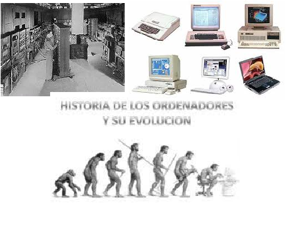
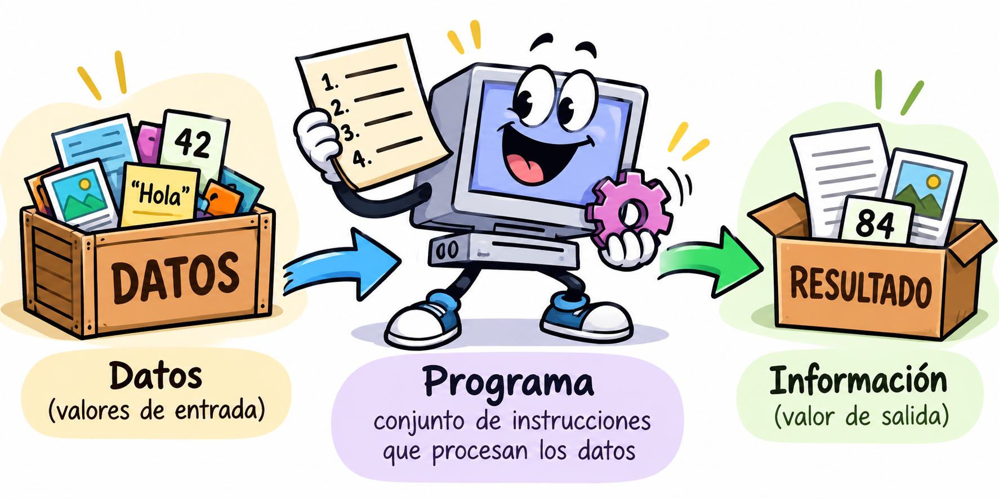
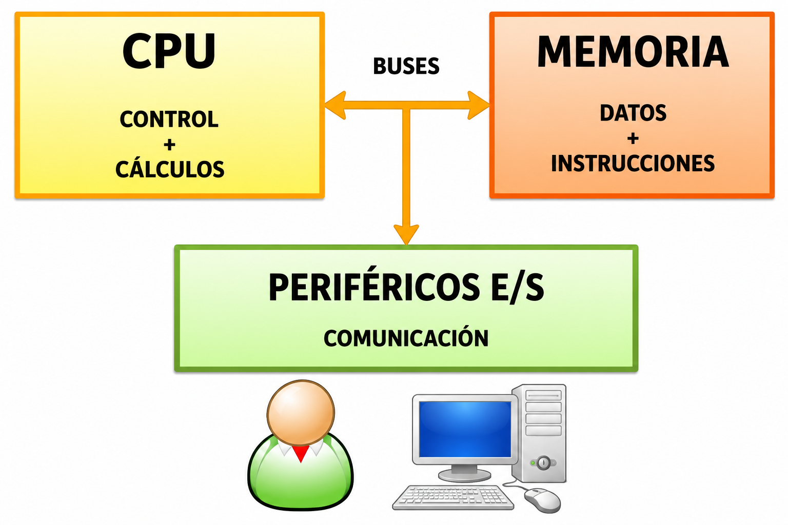
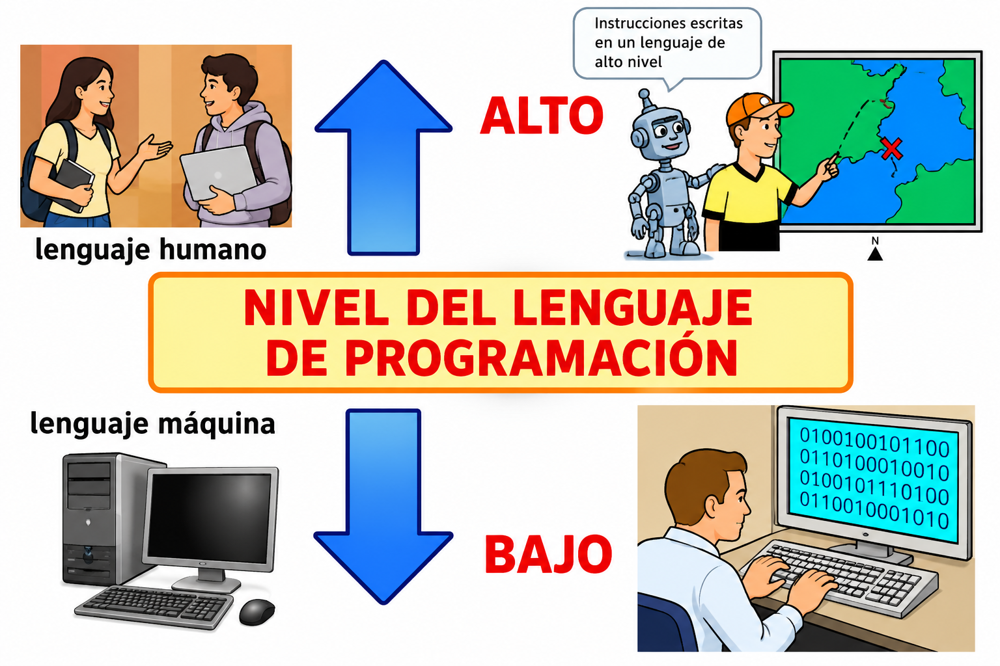
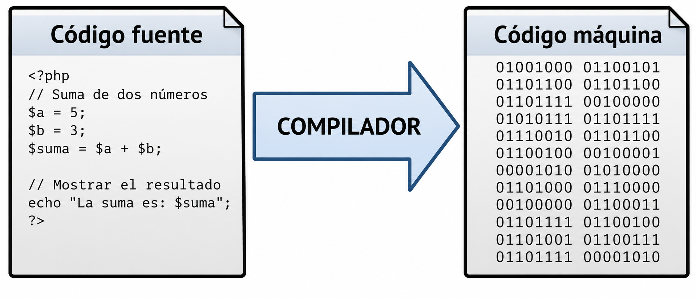
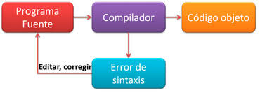
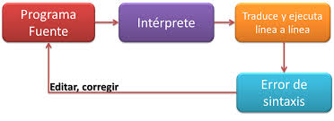
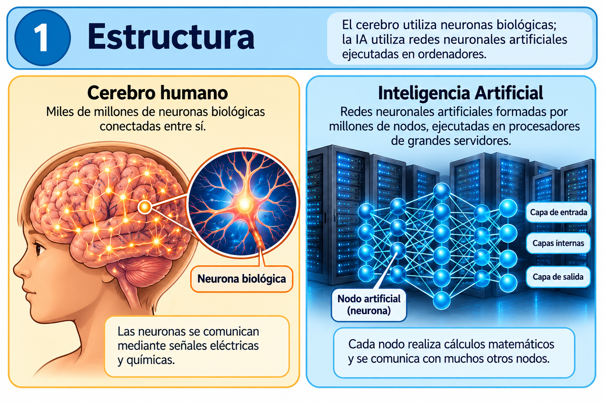
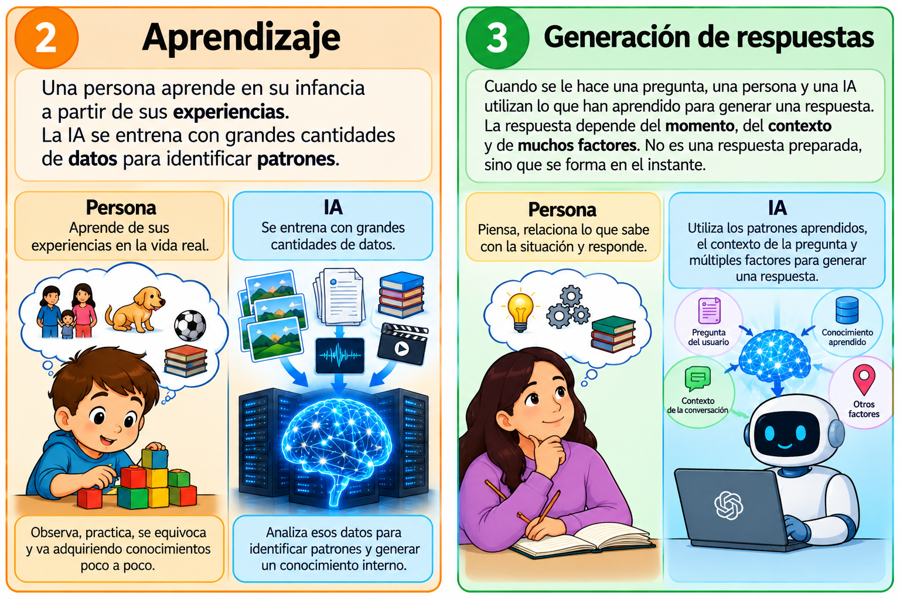
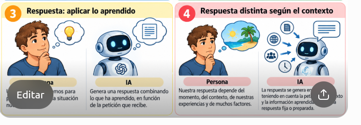


Entender qué es un programa
Qué es programar
Elementos que componen un programa
Introducción a las instrucciones y los datos que hay en los programas
Primer contacto en el curso con la programación: Scratch:



<details class="indice-tema" open>
<summary>Contenidos</summary>

[[toc]]

</details>


# Conceptos básicos en la programación

::: definicion Programa
Un **programa** es un conjunto de <color>instrucciones</color> indican al ordenador qué <color>operaciones debe realizar</color>.
:::

Los programas trabajan con **datos**, realizando operaciones sobre ellos para obtener resultados.

- Nosotros vamos a hacer programas para que los ejecute un ordenador.


::: definicion Ordenador
Máquina programable de propósito general para el tratamiento de la información o datos.
:::

- Los ordenadores han evolucionado rápidamente desde aproximadamente los años 1950 hasta nuestros días.



- Hay que diferenciar entre datos e información.

::: definicion Datos
Son símbolos que representan valores.
:::

::: definicion Información
Son datos que tienen un significado y aportan conocimiento.
:::

Un programa va a ser un sistema <color>IPO</color> como podemos ver en la siguiente imagen:


## Ordenador

- Es una máquina digital (1 y 0).
- Estamos acostumbrados a usar los ordenadores hoy en día.
- Se han convertido en electrodomésticos de nuestras casas.
- Los usamos habitualmente. Hoy en día no se conciben sin conexión a Internet.
- Entendemos por ordenador también las tablets, dispositivos móviles y cualquier dispositivo que tenga un procesador de propósito general, es decir, al que podamos incorporar programas que hagan cosas interesantes.
- Actualmente con la aparición de IA se han convertido en sistema que se asemejan a los humanos (no lo son) y podemos conversar con ellos

::: recuerda
Nosotros y nosotras estamos aquí para hacer esos interesantes programas, poco a poco.
:::


## Partes de un ordenador

- Debemos tener clara la idea de que un ordenador es una máquina de Von Neumann (considerado uno de los padres de la informática moderna).



- Es importante entender que el programa es un conjunto de instrucciones que se van ejecutando una a una.
- El programa reside en la memoria.
- Se ejecuta en el procesador.

## Lenguajes compilados e interpretados

::: definicion Programar
**Programar** consiste en diseñar y escribir las instrucciones que debe ejecutar un ordenador para realizar una tarea o resolver un problema.
:::

Para programar necesitamos:

- **Datos:** valores con los que trabaja el programa.
- **Instrucciones:** operaciones que realiza sobre esos datos.
- **Algoritmo:** secuencia ordenada de pasos para resolver un problema.


- Un programa se escribe en un lenguaje concreto.
- Un lenguaje está formado por una serie de elementos. Sin entrar en detalles y sin ser muy puristas, podemos afirmar:

::: recuerda Elementos de un lenguaje

**Lexemas**:  _Son las palabras que constituyen el lenguaje._

**Sintaxis**:  _Son las reglas que nos dicen cómo unir los lexemas para construir frases._. La mayoría comunes en prácticamente todos los lenguajes de programación, aunque cada lenguaje puede tener sus propias peculiaridades

**Semántica**: _Nos habla del significado de las frases._

```php
$edad = 25;
```
* **Lexemas**: $edad, =, 20, ;.
* **Sintaxis**: reglas que establecen cómo se combinan esos elementos:
  * identificador, el token =, un valor
* **Semántica**: significado de la instrucción: asignar el valor 20 a la variable $edad.
* 
:::

- Un programa escrito en un determinado lenguaje se dice que está en **alto nivel** (comprensible por las personas).

___

- El ordenador ejecuta instrucciones en binario (0 y 1), por lo que hay que traducirle el programa.
___



- Hay que traducir el programa de alto nivel a bajo nivel.

- Esto se puede hacer  <color>compilando o interpretando</color>.

### Compilación



### Interpretación



## Trabajamos con información y datos

- Cada uno de estos valores binarios se conoce como **bit**.

::: definicion Bit
Es la mínima unidad de información que se puede almacenar o transmitir.
:::

- Los bits se combinan para formar estructuras de información.
- La combinación de estos dos valores ofrece grandes posibilidades para representar diferentes valores.

::: actividad ¿Cuántos valores podemos representar?

- ¿Cuántos valores diferentes podemos representar con **2 bits**?
- ¿Y con **3 bits**?
- ¿Y con **n bits**?

:::

## La IA

- En los últimos años, la **Inteligencia Artificial (IA)** ha permitido desarrollar programas capaces de realizar tareas que asociamos con la inteligencia humana, como reconocer imágenes, comprender textos o mantener conversaciones.

- Aunque algunas de sus respuestas puedan parecer humanas, **la IA no es una persona ni piensa como nosotros**. Son sistemas informáticos que procesan datos mediante modelos y algoritmos.

- Para comprender bien la IA, vamos a hacer una analogía al cerebro humano:
___
<color>La estructura</color>
El cerebro utiliza neuronas biológicas; la IA utiliza redes neuronales artificiales ejecutadas en ordenadores

___
<color>El aprendizaje</color>
Las personas aprenden de sus experiencias; la IA se entrena con grandes cantidades de datos para identificar patrones

___
<color>La respuestas</color>
Ante una pregunta, la IA genera una respuesta utilizando los patrones aprendidos y el contexto disponible

___

## La inteligencia artificial como herramienta de aprendizaje

La **Inteligencia Artificial (IA)** puede ayudarnos a aprender programación, explicando conceptos, proponiendo ejemplos, detectando errores y resolviendo dudas.

Sin embargo, nuestro objetivo es **aprender a programar, no conseguir que la IA programe por nosotros**.

::: recuerda
**Utiliza la IA para aprender, no para evitar aprender.**

- Pide explicaciones cuando no entiendas algo.
- Solicita pistas antes de pedir soluciones.
- Intenta resolver los ejercicios por ti mismo.
- Pide que revise tu código y te explique los errores.
- Comprueba sus respuestas: la IA también se equivoca.
- No compartas contraseñas, datos personales ni información privada.
  :::

### Cómo preguntar a la IA

Cuanto más clara sea nuestra petición, más útil podrá ser su respuesta.

**Ejemplo:**

> Estoy empezando a aprender programación. Quiero entender cómo calcular la media de tres números. Explícamelo paso a paso, sin escribir código, y hazme preguntas para comprobar que lo he entendido.

::: actividad Aprendemos a preguntar a la IA

Utiliza una IA para comprender qué es un algoritmo.

1. Pídele una explicación sencilla.
2. Solicita un ejemplo de la vida cotidiana.
3. Pídele que te proponga un pequeño problema.
4. Intenta resolverlo sin que te dé la solución.
   :::
