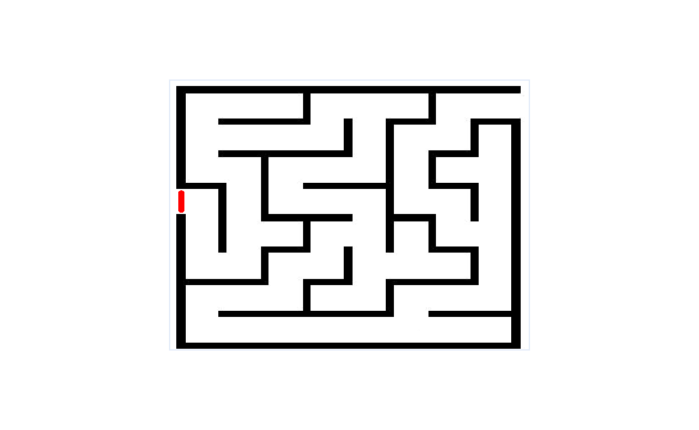
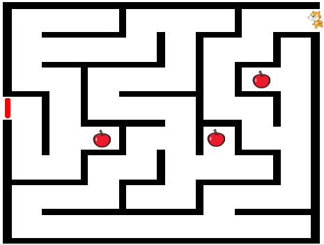

Vamos a realizar un videojuego en **Scratch** en el que el gato deberá recorrer un laberinto

* En él vamos a proponer una serie de requisitos que el juego deberá cumplir.

* Se pueden añadir ideas propias ideas y mejoras, pero primero cumplimos requisitos.
<color>Escenario</color>




___
<Color>RF 1</Color>

* **Movimiento del gato**: El jugador controlará al gato mediante las teclas de dirección del teclado. El gato deberá desplazarse por los pasillos del laberinto sin tocar las paredes.
* **Rertorno posición inicial**:  Si tocamos una pared,  regresará a la posición inicial.


<DropDown title="Implementación RF 1">

El personaje se moverá con las cuatro flechas del teclado y cambiará de disfraz en cada movimiento.

<table>
<tbody>
<tr>
<td width="50%">

**⬆️ Flecha arriba**

```scratchblocks
al presionar tecla [flecha arriba v]
fijar estilo de rotación [en todas direcciones v]
apuntar en dirección (0)
mover (10) pasos
siguiente disfraz
```

</td>
<td width="50%">

**⬇️ Flecha abajo**

```scratchblocks
al presionar tecla [flecha abajo v]
fijar estilo de rotación [en todas direcciones v]
apuntar en dirección (180)
mover (10) pasos
siguiente disfraz
```

</td>
</tr>
<tr>
<td>

**⬅️ Flecha izquierda**

```scratchblocks
al presionar tecla [flecha izquierda v]
fijar estilo de rotación [izquierda-derecha v]
apuntar en dirección (-90)
mover (10) pasos
siguiente disfraz
```

</td>
<td>

**➡️ Flecha derecha**

```scratchblocks
al presionar tecla [flecha derecha v]
fijar estilo de rotación [izquierda-derecha v]
apuntar en dirección (90)
mover (10) pasos
siguiente disfraz
```

</td>
</tr>
</tbody>
</table>

</DropDown>


___ 

<Color>RF 2</Color>

**Añadimos vidas al gato**

Vamos a incorporar un sistema de **vidas** para nuestro personaje.

- **Situación inicial:** el gato comienza con **5 vidas**.
- **Tocado:** cada vez que el gato toque una pared o borde del laberinto, perderá una vida.
- **Aviso:** el gato mostrará durante **2 segundos** un mensaje indicando cuántas vidas le quedan.
- **Fin del juego:** cuando el gato se quede sin vidas, terminará la partida.
- **Reto:** conseguir que, durante los 2 segundos que aparece el mensaje, **el gato no pueda moverse**.

<DropDown title="Implementación RF 2">

<Color>1. Crear la variable vidas</Color>
Creamos una variable llamada `vidas` para todos los objetos.

Al comenzar la partida, le asignamos el valor 5.

```scratchblocks id="v2inicio"
al presionar bandera verde
dar a [vidas v] el valor (5)
```

#### 2. Detectar las colisiones con la pared

Comprobamos continuamente si el gato está tocando el color de la pared.

```scratchblocks id="v2pared"
al presionar bandera verde
por siempre
    si <¿tocando el color [#000000]?> entonces
        cambiar [vidas v] por (-1)
        decir (unir [Vidas restantes: ] (vidas)) durante (2) segundos
        si <(vidas) = (0)> entonces
            decir [¡Fin del juego!] durante (2) segundos
            detener [todos v]
        fin
        posicion_inicial
    fin
fin
```

* El bloque posicione_inicial sería:

```scratchblocks
definir posicion_inicial
ir a x: (208) y: (143)
apuntar en dirección (-90)
```

::: warning Importante
Debemos seleccionar el color real de la pared con el cuentagotas de Scratch.

:::

<Color>Reto: bloquear el movimiento durante 2 segundos</Color>

Podemos crear una variable llamada `detenido`.

- `false`: el gato puede moverse.
- `true`: el gato no puede moverse.

Con esto introducimos estos valores **lógicos o booleanos** que tanto se van a utilizar en nuestros programas

Cuando detectamos un toque con el borde (o sitaciones en las que queremos detener el programa) , establecemos `detenido` a `true` durante los dos segundos del mensaje y, después del aviso, volvemos a `false`.

En los cuatro bloques de movimiento del RF 1 añadimos una condición:

En  el bloque donde detectamos la colisión o toque:

```scratchblocks id="v2bloqueo"
 si <¿tocando el color [#000000]?> entonces
    cambiar [detenido v] por (true)
    decir (unir [Vidas restantes: ] (vidas)) durante (2) segundos
    cambiar [detenido v] por (false)
    
fin
```

y ahora en cada uno de los cuatro movimientos, tenemos en cuenta el valor de **detenido**, por ejemplo en una tecla cualquiera:

```scratchblocks
al presionar tecla [flecha derecha v]
    si <detenido  = false > entonces
    fijar estilo de rotación [izquierda-derecha v]
    apuntar en dirección (90)
    mover (10) pasos
    siguiente disfraz
fin
```

De esta manera, el gato no responderá a las flechas mientras esté bloqueado.

</DropDown>

___ 

<Color>RF 4</Color>

 **Añadimos un nuevo scratch de Manzanas**:
  
 
* Vamos a añadir 3 manzanas al escenario
* Las coloracremos estratégicamente en posiciones escondidas del laberinto
* El gato deberá de comerse las manzanas para poder llegar a la meta y ganar
* Cuando el gato se coma una manzana, esta desaparecerá y aumentará el contador de manzanas recogidas
* Al final el gato deber´a de haber comido todas las manzanas para poder llegar a la meta y ganar
  * Aquí aparecerá un problema que deberemos de resolver. <Color>Los clones</Color>


<DropDown title="Implementación RF 3: Crear tres manzanas con clones">

<Color>Inicializar el contador</Color>

Al comenzar la partida, ponemos el contador  de manzanas a cero.

Debemos crearunos una variable de manzanas

```scratchblocks id="manzanas0"
al presionar bandera verde
dar a [manzanas v] el valor (0)
```

<Color>Crear las manzanas</Color>

Utilizaremos **clones** para crear tres manzanas a partir de un único objeto.

En el objeto **Manzana**, añadimos los siguientes bloques:


```scratchblocks id="applecreate"
al presionar bandera verde
esconder
ir a x: (89) y: (140)
crear clon de [mí mismo v]
ir a x: (142) y: (-69)
crear clon de [mí mismo v]
ir a x: (144) y: (-149)
crear clon de [mí mismo v]
```

<Color>Mostrar los clones</Color>

Cada clon aparecerá en la posición en la que fue creado.

```scratchblocks id="appleshow"
al comenzar como clon
mostrar
```

<Color>Recoger las manzanas</Color>

Cuando el gato toque una manzana, esta desaparecerá.

```scratchblocks id="applecollect"
al comenzar como clon
mostrar
por siempre
    si <¿tocando [Gato v]?> entonces
        cambiar [manzanas v] por (1)
        eliminar este clon
    fin
fin
```

Alternativamente podríamos utilizar este otro bloque 

```scratchblocks id="applecollect"
al comenzar como clon
mostrar
esperar hasta que <¿tocando [Gato v]?>
cambiar [manzanas v] por (1)
eliminar este clon
``` 
::: tip Recuerda
Los clones son copias de un mismo objeto que pueden tener posiciones y comportamientos independientes.

No necesitamos crear tres objetos diferentes: **un único objeto Manzana y tres clones** son suficientes.
:::

</DropDown>


___
<Color>RF 4</Color>
4. **Frutas guardianas**
    - Cada manzana estará protegida por una fruta guardiana.
    - Las frutas guardianas deberán moverse para dificultar que el gato consiga las manzanas.
    - Si el gato toca una fruta guardiana, perderá una vida y retornará a su situación inicial.
___


<Color>RF 4</Color>

**4. Frutas guardianas**

Cada manzana estará protegida por una **fruta guardiana** que se moverá continuamente para impedir que el gato consiga recogerla.

- Crearemos un nuevo objeto llamado `Guardian`.
- Utilizaremos **clones** para crear tres guardianes, uno por cada manzana.
- Cada guardián tendrá una posición inicial y realizará un movimiento de vigilancia.
- Los guardianes se desplazarán automáticamente de un lado a otro.
- Si el gato toca un guardián:
   - Perderá una vida.
   - Regresará a su posición inicial.
   - Permanecerá bloqueado durante 2 segundos.

<DropDown title="Implementación RF 4" password="guardianes">

<Color>Crear las bolas guardianas</Color>

Utilizaremos un único objeto y crearemos tres clones, cada uno con su posición, dirección y recorrido.

Las variables `pasos` y `direccion` deben crearse seleccionando **«Solo para este objeto»**, para que cada clon conserve sus propios valores.

```scratchblocks
al presionar bandera verde
esconder
ir a x: (74) y: (15)
dar a [pasos v] el valor (90)
dar a [direccion v] el valor [y]
crear clon de [mí mismo v]

ir a x: (23) y: (51)
dar a [pasos v] el valor (90)
dar a [direccion v] el valor [y]
crear clon de [mí mismo v]

ir a x: (9) y: (-151)
dar a [pasos v] el valor (120)
dar a [direccion v] el valor [x]
crear clon de [mí mismo v]
```

<Color>Comportamiento de cada clon</Color>

Cuando se crea un clon, se muestra y ejecuta el subprograma `vigilar`, utilizando sus propios valores de `pasos` y `direccion`.

```scratchblocks
al comenzar como clon
mostrar
vigilar (pasos) (direccion)
```

<Color>Definición del subprograma vigilar</Color>

El subprograma recibe dos parámetros:

- `pasos`: distancia que recorrerá la bola.
- `direccion`: eje de movimiento (`x` horizontal o `y` vertical).

```scratchblocks
definir vigilar (pasos) (direccion)
por siempre
    si <(direccion) = [x]> entonces
        deslizar en (2) segs a x: ((posición en x) + (pasos)) y: (posición en y)
        deslizar en (2) segs a x: ((posición en x) - (pasos)) y: (posición en y)
    si no
        deslizar en (2) segs a x: (posición en x) y: ((posición en y) + (pasos))
        deslizar en (2) segs a x: (posición en x) y: ((posición en y) - (pasos))
    fin
fin
```

::: recuerda

Con este ejemplo estamos combinando dos conceptos importantes:

- **Clones:** permiten crear varias bolas guardianas a partir de un único objeto.
- **Subprogramas con parámetros:** permiten que todas compartan el mismo código, pero se comporten de forma diferente.

Cada clon conserva sus propios valores de `pasos` y `direccion`, gracias a las variables **«Solo para este objeto»**.

:::
</DropDown>

<Color>RF 5</Color>

5. **Sistema de vidas**
    - El gato comenzará con **5 vidas**.
    - Cada vez que toque una pared del laberinto o una fruta guardiana:
        - Perderá una vida.
        - Regresará a la posición inicial.
    - Si pierde las cinco vidas, el juego terminará mostrando un mensaje de **«Game Over»**.
___
<Color>RF 6</Color>
6. **Meta y victoria**
    - El laberinto tendrá una meta claramente identificada.
    - Para ganar, el gato deberá haber recogido **todas las manzanas** y llegar a la meta.
    - Si llega a la meta sin haber recogido todas las manzanas, no podrá finalizar el juego.
    - Cuando consiga su objetivo, aparecerá un mensaje de **«¡Enhorabuena, has ganado!»**.
___
<Color>RF 7</Color>
## Ampliación opcional ⭐

Incorpora un **cronómetro** que permita establecer un tiempo máximo para completar el laberinto.

- El tiempo comenzará a contar al iniciar la partida.
- El jugador deberá recoger todas las manzanas y llegar a la meta antes de que se agote.
- Si se termina el tiempo, perderá la partida.
- Si consigue completar el laberinto, se mostrará el tiempo empleado.

